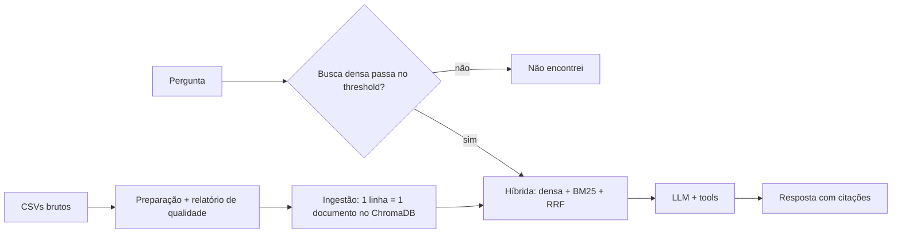

# Hybrid Search RAG: Northwind Dataset

Template de RAG para perguntas em linguagem natural sobre **CSVs**, com:

- **Busca híbrida:** densa (ChromaDB + `gemini-embedding-001`) + léxica (BM25), fundidas por Reciprocal Rank Fusion (RRF);
- **Portão de escopo:** threshold calibrado na busca densa; pergunta fora da base nem chega à LLM;
- **Tools analíticas em pandas:** totais, rankings e comparações calculados de forma determinística (a LLM só escolhe a tool e os parâmetros);
- **Citações rastreáveis:** `[tabela:id]` para documentos e `[ferramenta:nome]` para cálculos, com validação automática;
- **Avaliação:** F1 de abstenção, recall de contexto, recall de valores e Faithfulness (RAGAS).

Vem pronto para rodar com a base de exemplo **Northwind** (pedidos de uma distribuidora fictícia de alimentos). Para usar com os seus dados, siga [Como adaptar](#como-adaptar-para-a-sua-base).

## Arquitetura



| Etapa | Arquivo | O que faz |
|---|---|---|
| Preparação | [`src/01-preparacao.ipynb`](src/01-preparacao.ipynb) | Lê `data/raw`, corrige formato, padroniza nomes e tipos, gera `data/processed` e `data/quality/qualidade_dados.csv` |
| Configuração | [`src/config.py`](src/config.py) | Modelos, `TOP_K`, threshold e cliente Gemini com retry limitado |
| Ingestão | [`src/ingest.py`](src/ingest.py) | Desnormaliza (`enrich`), transforma cada linha em texto e grava os embeddings no ChromaDB |
| Recuperação | [`src/retrieval.py`](src/retrieval.py) | Busca densa com threshold, BM25 e fusão RRF |
| Tools | [`src/tools.py`](src/tools.py) | `consultar_total`, `ranking` e `comparar_anos` em pandas, com validação e ressalvas |
| Geração | [`src/generate.py`](src/generate.py) | Prompt, chamada à LLM com tools, validação de citações; roda o dataset de avaliação |
| Terminal | [`src/main.py`](src/main.py) | Loop de perguntas com rastreio de documentos e tools, com log em `eval/logs/` |
| Calibração | [`src/calibrate_threshold.py`](src/calibrate_threshold.py) | Distâncias de perguntas dentro e fora do escopo, com sugestão de threshold |
| Gabarito | [`eval/gabarito.ipynb`](eval/gabarito.ipynb) | Respostas esperadas calculadas em pandas, **sem** importar as tools |
| Avaliação | [`src/Evals.ipynb`](src/Evals.ipynb) | Métricas sobre as respostas geradas |

## Como rodar

Requer Python 3.14 e uma chave gratuita da API do Gemini ([Google AI Studio](https://aistudio.google.com/)).

```bash
# 1. Ambiente e dependências
python -m venv venv
source venv/bin/activate          # Windows: venv\Scripts\activate
pip install -r requirements.txt

# 2. Configuração: copie o exemplo e preencha GEMINI_API_KEY
cp .env.example .env

# 3. (opcional) Preparação: data/processed e data/quality já vêm prontos.
#    Para refazer, rode src/01-preparacao.ipynb do início ao fim (sem chamadas de API).

cd src

# 4. Autoteste das tools (local, sem API): confere os números com o gabarito
python tools.py

# 5. Indexação: ~1.050 documentos em 11 lotes, ~10 min por causa da pausa entre lotes
#    (o plano gratuito limita 100 textos/min no embedding)
python ingest.py

# 6. Calibração do threshold (1 requisição de embedding). Ajuste MAX_DISTANCE no .env
#    com o valor sugerido; os resultados podem ser vistos em eval/calibracao_threshold.ipynb
python calibrate_threshold.py

# 7. Perguntas livres pelo terminal
python main.py

# 8. Avaliação: responde eval/dataset.csv e salva em eval/respostas_<modelo>.json
python generate.py
#    depois abra src/Evals.ipynb e rode tudo. As seções 0 a 4 são locais;
#    a seção 5 (Faithfulness) chama o Gemini como juiz (~2 requisições por resposta).
```

> **O threshold padrão (`0.34`) é só um ponto de partida.** Ele depende do modelo de embedding, do formato dos documentos e do idioma das perguntas e dos dados. Rode a calibração antes de confiar nas recusas.

### Usando o `main.py`

Digite a pergunta depois do `>`. Para encerrar, digite `sair` ou use Ctrl+D. Ctrl+C cancela só a pergunta em andamento.

```text
> Quem é o supervisor da Anne Dodsworth?
```

| Linha | O que mostra |
|---|---|
| `tool:` | Tool chamada e seus parâmetros, com `erro` e `ressalva` quando houver |
| `doc:` | Documento enviado à LLM, de qual busca veio (`densa`, `bm25` ou as duas) e seu score RRF |
| `(fora do escopo ...)` | Nenhum documento passou no threshold e a LLM não foi chamada |
| `⚠ citações inválidas` | A resposta citou um ID que não estava no contexto |

Cada pergunta consome 1 requisição de geração, 2 quando usa uma tool, e 0 quando é barrada pelo threshold.

## Estrutura

```text
data/
  raw/            CSVs originais (nunca alterados)
  processed/      CSVs tratados: 1ª coluna = chave única de cada tabela
  quality/        qualidade_dados.csv: problemas encontrados e tratamento (também indexado)
  chroma/         índice vetorial (gerado pelo ingest.py, fora do git)
src/              pipeline, tools e notebooks de preparação e avaliação
eval/             gabarito, dataset de avaliação, calibração, respostas e resultados
```

## Como adaptar para a sua base

Os pontos ligados ao domínio estão marcados com `ADAPTE` no código (`grep -rn ADAPTE src`).

1. **Dados:** coloque seus CSVs em `data/raw/` e reescreva `src/01-preparacao.ipynb`. O contrato é gerar `data/processed/<tabela>.csv` com a **chave única na 1ª coluna** e, se quiser, o relatório `data/quality/qualidade_dados.csv`.
2. **`ingest.py`:**
   - `COLLECTION`: nome da coleção;
   - `NOT_INDEXED`: tabelas usadas só pelas tools (ex.: tabelas de itens sem chave única);
   - `enrich()`: copie para cada linha os nomes das tabelas relacionadas. O RAG não faz join: um pedido com só `id_cliente: QUICK` não é encontrado por "pedidos da QUICK-Stop".
3. **`retrieval.py`:** `STOPWORDS` no(s) idioma(s) das perguntas e dos dados.
4. **`generate.py`:** `DOMAIN`, a frase que descreve a base no system prompt. As regras do prompt são genéricas.
5. **`tools.py`:** o arquivo mais ligado ao domínio. Mantenha o padrão de cada tool (validar parâmetros → filtrar → agregar → devolver `ressalvas`, `citacao` e `criterio`) e troque tabelas, métricas e agrupamentos. Atualize os `assert`s do autoteste.
6. **`calibrate_threshold.py`:** ~10 perguntas dentro e ~10 fora do escopo, incluindo perguntas *do mesmo domínio* que a base não responde. Rode e ajuste `MAX_DISTANCE`.
7. **`eval/gabarito.ipynb`:** suas perguntas e respostas esperadas, calculadas em pandas **sem importar `tools.py`**; se o gabarito usasse o mesmo código, um erro de cálculo apareceria nos dois e passaria na avaliação.

## Decisões técnicas

**Busca híbrida com RRF.** Em dados tabulares, a busca léxica acerta termos exatos (IDs, nomes, valores) e a densa acerta sinônimos e paráfrases (inclusive entre idiomas: perguntas em português, dados em inglês). O RRF combina as duas pelas **posições**, sem precisar normalizar scores de escalas diferentes. Cada busca traz `2 * TOP_K` candidatos e a fusão usa `RRF_K = 60` (valor do artigo original, Cormack et al., 2009).

| Parâmetro | Valor | Motivo |
|---|---|---|
| `TOP_K` | 5 | Documentos enviados à LLM: reranking útil sem poluir o contexto |
| Candidatos por busca | `2 * TOP_K` | Busca ampla antes da fusão |
| `RRF_K` | 60 | Evita que o 1º lugar de uma única lista domine o ranking |
| `MAX_DISTANCE` | calibrado | Distância de cosseno máxima na busca densa |

**Portão de escopo só na busca densa.** O BM25 sempre encontra alguma palavra em comum, então não serve para recusar. Se nenhum documento passa no threshold denso, a resposta é a recusa padrão e a LLM não é chamada (economiza cota e evita invenção). Perguntas do mesmo domínio que passam no threshold dependem da regra de recusa do prompt.

**1 linha = 1 documento.** Em dados tabulares a linha já carrega o contexto da informação. O texto usa `coluna: valor` (`Tabela: produtos | produto: Chai | preco_unitario: 18.0 | ...`), o que dá sentido semântico e léxico a números soltos. Campos nulos são omitidos.

**Tools em vez de Text-to-SQL.** A busca devolve só `TOP_K` linhas, então nunca pode somar a base inteira. Text-to-SQL seria mais flexível, mas abre espaço para consultas erradas e números inventados. Tools parametrizadas cobrem as famílias de perguntas mais comuns (total, ranking, comparação) com resultado determinístico. Elas validam os parâmetros antes de calcular e devolvem erro com as opções válidas, pedem desambiguação quando um nome bate com mais de uma entidade e devolvem `ressalvas` que o prompt obriga a mencionar (ex.: ano parcial, grupo sem dados ≠ zero).

**Gemini no plano gratuito.** Um provedor e uma chave para LLM, embedding e juiz. O embedding é multilíngue e diferencia `RETRIEVAL_DOCUMENT` de `RETRIEVAL_QUERY`. O cliente tem retry limitado (3 tentativas, 30 s cada) para falhar rápido quando o modelo está sobrecarregado (503/504).

**Relatório de qualidade indexado.** Cada problema encontrado na preparação vira um documento, então o RAG responde "os dados estão limpos?" citando a fonte.

## Avaliação

O dataset de exemplo (`eval/dataset.csv`, 13 perguntas) cobre 5 tipos: `consulta` (BM25), `semantica` (densa, PT → EN), `fora_escopo`, `analitica` (tools) e `qualidade`.

| Métrica | Avalia | Como |
|---|---|---|
| `f1_abstention` | Recusou quando devia e respondeu quando devia | Precision e recall da recusa |
| `context_recall` | O retriever trouxe os documentos esperados | TP / (TP + FN) por documento |
| `values_recall` | Os números esperados aparecem na resposta | TP / (TP + FN) por valor, lendo formato BR e US |
| `faithfulness` | A resposta é fiel ao contexto | RAGAS: afirmações sustentadas / total |

Algumas perguntas são "pegadinhas" de propósito. A P10 compara 1997 com 1998, mas 1998 só tem pedidos até maio: a resposta esperada exige a ressalva de ano parcial. Já a P07 pergunta o salário de uma funcionária que existe, mas o dado de salário não existe na base.

## Limitações

- **Analítica limitada às 3 tools:** participação percentual, tendência mensal e agregações com duas dimensões exigem novas tools.
- **Sem memória de conversa:** cada pergunta é independente ("e em 1997?" não é entendido).
- **BM25 sem stemming:** variações de palavra ("pedido" × "pedidos") dependem da busca densa.
- **Threshold sensível:** precisa ser recalibrado quando mudam o modelo de embedding, o formato dos documentos ou a base.
- **Plano gratuito:** cotas baixas e disponibilidade não garantida; a ingestão é lenta pela pausa entre lotes.
- **Avaliação pequena e juiz igual ao gerador:** serve para comparar versões do sistema, não para conclusões estatísticas.
- **Dados pessoais:** tudo que está no índice pode ir no prompt para uma API externa. Com dados reais, avalie anonimização antes de indexar.

## Dados de exemplo

[Northwind](https://github.com/microsoft/sql-server-samples/tree/master/samples/databases/northwind-pubs), banco de exemplo da Microsoft distribuído sob a licença MIT (Copyright (c) Microsoft Corporation). Os CSVs em `data/raw` vêm de [`neo4j-contrib/northwind-neo4j`](https://github.com/neo4j-contrib/northwind-neo4j) e foram mantidos sem alteração, exceto pela omissão das tabelas de territórios e regiões. Os dados são fictícios.
